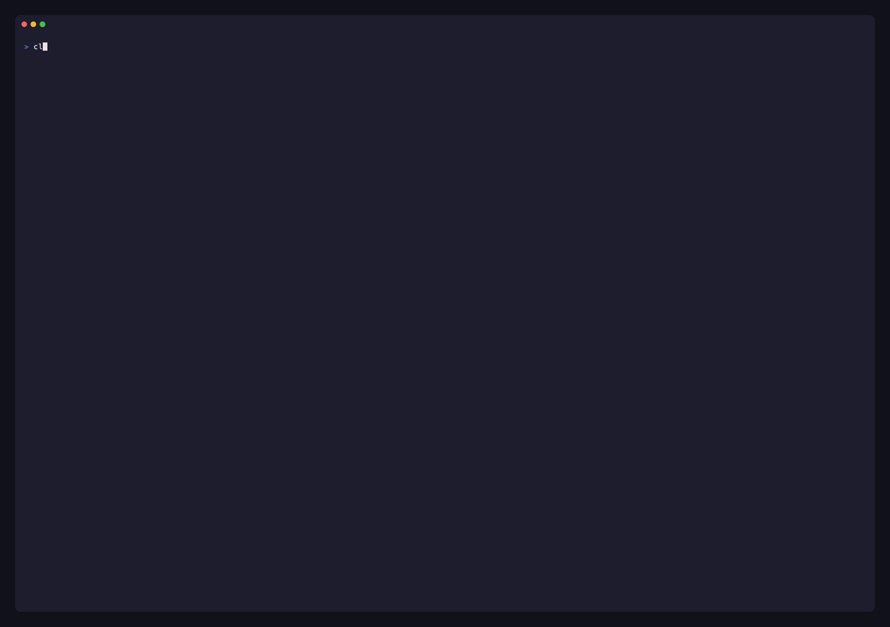

# Kreative Krew

**Turn your Claude Code sessions into an engineering crew with a Manager.**



*Recorded with `/krew-demo` (a seeded crew; nothing real runs). The tape is [`demo/demo.tape`](demo/demo.tape).*

Kreative Krew is a [Claude Code mod](https://code.claude.com/docs/en/plugins/mods/overview) (a plugin of function hooks). One session becomes the **Manager**; a session that loads the mod becomes a **worker** when it was hired by the Manager (or carries `KREW_NAME`) or runs under the Manager's project root. Sessions in other projects stay untouched. The Manager never writes code: it compiles your rough asks into structured briefs that *you approve*, dispatches them to workers in isolated worktrees, watches every worker's health, rotates burnt-out workers to fresh successors with a verified handoff, keeps a collision radar between branches, runs a merge queue, and only interrupts you when something actually needs a human.

```
┌ transcript ───────────────────────────┐┌ Inbox 3 · Team · Radar · Money · Replay ──────┐
│ > /brief add a dark mode toggle       ││ KREATIVE KREW · steady mode    ●2 ◆1 ○1 · $11 │
│                                       ││ NEEDS YOU · risk first                         │
│ ┌ KREW · krew_brief ────────────────┐ ││ ✎ Brief for approval: Dark mode toggle → Pixel │
│ │ Brief b7 "Dark mode toggle"…      │ ││   Goal: Users can switch themes from Settings  │
│ └───────────────────────────────────┘ ││   [a] Approve & send  [v] Revise  [x] Reject   │
│                                       ││ 1. ⟳ Rex is degraded (same error after 4 fix…  │
│                                       ││   [w] Swap → Rex II  Compact instead  Ignore   │
│                                       ││ 2. ⑂ Nova retry with backoff, or queue?        │
│                                       ││   draft: “Queue them: keep the idempotency…”   │
│                                       ││   [s] Send draft  [y] Reply  [o] Done          │
├───────────────────────────────────────┤└────────────────────────────────────────────────┘
│ KREW ●Atlas login rate 61% ◆Nova billing 44% ●Rex flaky sea 87% ○Juno docs 23% ⚡1       │
│ >                                                                                      │
│ KREW · 3 need you · $4.20/h · 1 conflict                              ? for shortcuts  │
└────────────────────────────────────────────────────────────────────────────────────────┘
```

## Why

Running five coding agents in parallel is easy. Managing them is not:

- **You become the bottleneck.** Human review tops out at roughly 4–8 parallel agents.
- **Branches pass alone and break together.** Git only catches text conflicts.
- **Agents collide** on ports, databases and the same files.
- **Long sessions quietly degrade** (“context rot”): agents loop, forget rules, redo work.
- **Costs are invisible** until the bill.

Kreative Krew is the integration layer those agents are missing. The design decisions come from published research; see [docs/RESEARCH.md](docs/RESEARCH.md).

## What it does

| Pillar | What you get |
|---|---|
| **Brief compiler** | Say “add dark mode”. The Manager compiles a brief: a tailored team of expert roles, your ask cleaned into a clear task, a fixed “understand first” section, goal, context, acceptance criteria, files the worker owns / must not touch, verification steps, known dead ends, budget and your standing rules. Plan tasks ask for an ASD-STE100 HTML artifact and hire at `--effort high`. **You approve, revise or reject it before any worker sees it.** See [docs/BRIEF-STYLE.md](docs/BRIEF-STYLE.md). |
| **Evidence inbox** | Only what needs you, ranked by risk. PRs show evidence first: fresh-context review, independent spec-derived tests, a goal check, CI. Low-risk questions are batched and replies are pre-drafted (one key to send). |
| **Witness** | Loop detection (same call ×3, A→B→A), edit-test micro-loops, stalls, drift outside the owned area, invented paths. |
| **Burnout & succession** | A **sharpness** score per worker. Hard triggers (the same error after repeated fixes, context near compaction, rule breaks) or a low score propose a rotation; planned rotations happen at a natural boundary once context passes ~50%. The handoff packet is **extracted from git and the event log**, the tired worker's own account is **audited by a fresh judge**, and the successor **re-verifies every “done” claim** and can `ask_predecessor`. |
| **Collision radar** | `git merge-tree` dry-runs between live branches every 3 minutes plus a territory map of who edits what. Both agents get a heads-up before a PR ever conflicts. |
| **Refinery** | A merge queue: rebase on main, rerun CI, merge; on a conflict the owner is told to re-implement from intent rather than hand-merge text. |
| **Runtime isolation** | Every hire gets its own git worktree under `<root>/tmp/`, a port range and a database name in `.env.krew`. |
| **Treasury** | Cost per agent, burn rate, runway, budget per brief, cost per merged PR. |
| **Flight recorder** | A replay timeline of every edit, test, commit, PR, verdict and handoff, filterable by agent. |
| **Storyteller** | `focus` (digests twice a day, only high risk interrupts), `steady`, `war` modes. |
| **Fun layer** | Control groups (`/g 1 rebase on main`), spoken standups, moods tied to real signals, an end-of-day match report, chaos drills. |

Everything runs on Claude Code's native plumbing: cross-session messaging, `claude --bg` background sessions, the shared `$.store`, usage/cost events, mod-defined subagent types and the terminal UI renderer. No tmux required (it is supported as an alternative hire mode).

## Install

Requires Claude Code **2.1.299 or newer** and `gh` for PR features.

```bash
/plugin install kreative-krew --marketplace Kreativepardha/kreative-krew
```

or from a local clone:

```bash
git clone https://github.com/Kreativepardha/kreative-krew ~/claude-mods/kreative-krew
claude plugin marketplace add ~/claude-mods/kreative-krew
claude plugin install kreative-krew@kreative-krew --scope user
```

Run `/reload-plugins` in any open session. The dashboard docks beside the transcript in fullscreen mode (`/fullscreen` or the `fullscreen` setting); otherwise it appears above the prompt.

## Use

1. In the session that should manage the crew: **`/krew-lead`**. The dashboard opens.
2. Ask for work in plain words, or use `/brief <ask>`, `/assign <agent> <ask>`, `/hire <Name> <ask>`. The Manager compiles the brief and the **Inbox** shows it with **Approve & send / Revise / Reject**.
3. Approving sends the brief to an existing worker, or hires one: `claude --bg -n <Name> …` in a fresh worktree (set the `hireMode` option to `tmux` for tmux windows). Workers load the mod automatically and report to the Manager.
4. Watch the **Inbox**. Press the number's hotkeys: `s` send the drafted reply, `y` reply, `g` queue a green PR for the refinery, `w` approve a rotation, `o` done.
5. `/standup` (add `voice` to hear it), `/match-report`, `/krew-mode focus|steady|war`, `/krew-push on|off`, `/g 1 add Atlas,Nova` then `/g 1 <order>`, `/retire <agent>`, `/swap <agent>`, `/krew-drill`.

Try it without spending anything: **`/krew-demo`** seeds a fake crew (Atlas, Nova, Rex, Juno) with a pending brief, a proposed rotation, a conflict and a PR with evidence. `/krew-demo off` removes it.

### Worker side

Workers get a session-scoped system prompt section (their name, owned area, do-not-touch list, worktree, ports) and these tools:

`krew_board` · `krew_note` · `ask_manager(text, kind, url?, options?)` · `krew_handoff` · `krew_warmup_done` · `ask_predecessor` · `krew_retire_ready`

Attach to a background worker any time with `claude attach <session id>` (the inbox has a copy button).

### Options

Set in `/config` or `pluginConfigs`: `fastModel` (default `claude-haiku-5-5`: cards, digests, drafts, messages), `smartModel` (default `claude-sonnet-5-5`: briefs, judging, handoff audits), `workerModel`, `hireMode` (`bg` | `tmux`), `rotateAt` (context %, default 50), `defaultBudgetUsd`, `canary` (experimental quiz before a swap), `claudeArgs` (extra flags for hired workers, e.g. `--permission-mode acceptEdits`), `standingRules` (text appended to every brief).

## How succession works

```
detect ─► freeze ─► handoff packet ─► fresh judge audit ─► spawn successor ─► warm-up ─► retire predecessor
          finish     facts from git +    flags where the     same worktree,     runs tests,   after the successor
          the step,  event log + the     account and the     branch, ports;     re-verifies   confirms; memory saved;
          commit WIP worker's account    facts disagree      packet attached    “done” items  worktree kept if dirty
                                                                    ▲                │
                                                                    └── ask_predecessor
```

The predecessor stays reachable until the successor calls `krew_warmup_done`. If a successor degrades again within 30 minutes, the Manager suggests splitting the task instead of a third generation.

## Development

```bash
claude plugin validate .        # manifest, hooks, every $ call the module makes
claude plugin test .            # tests/*.test.ts against the real engine
tsc -p .                        # after the mod has loaded once (types are laid in .claude-plugin/types)
```

Layout: `hooks/register.tsx` (entry), `hooks/lead.ts` (Manager), `hooks/worker.ts` (worker), `hooks/core/*` (pure helpers: witness, brief compiler, store I/O, demo data), `hooks/ui/*` (pane, band, pills, cards), `types/index.d.ts` (the `$.state` contract). See [docs/ARCHITECTURE.md](docs/ARCHITECTURE.md).

## Safety notes

Mods run in-process with your user's permissions. Kreative Krew runs `git`, `gh`, `claude` and (optionally) `tmux`; it writes only under the shared plugin store, each worker's worktree (`.env.krew`) and `git worktree` paths it created. Retiring never force-removes a dirty worktree and never touches any memory directory. The Manager session is hard-blocked from `Edit`, `Write` and `NotebookEdit`.

## License

MIT © [Kreativepardha](https://github.com/Kreativepardha)
